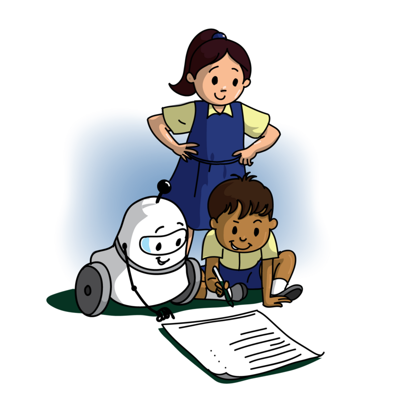

# Task 4: Bang-Bang Line Following and P Controller

    

**Duration:** 1 week

## Brief

Two stages this week, building directly on [Bang bang controller](../../Learning/Introduction%20to%20robotics/Bang%20bang%20controller.md) and [PID controller](../../Learning/Introduction%20to%20robotics/PID%20controller.md) (the P section of that page is all you need for now):

- **Part A:** Implement a bang-bang line follower and observe the rapid oscillations it causes.
- **Part B:** Implement a P controller and observe how the output changes as you try different `Kp` values.

See [Assignment](Assignment.md) for what to submit.
