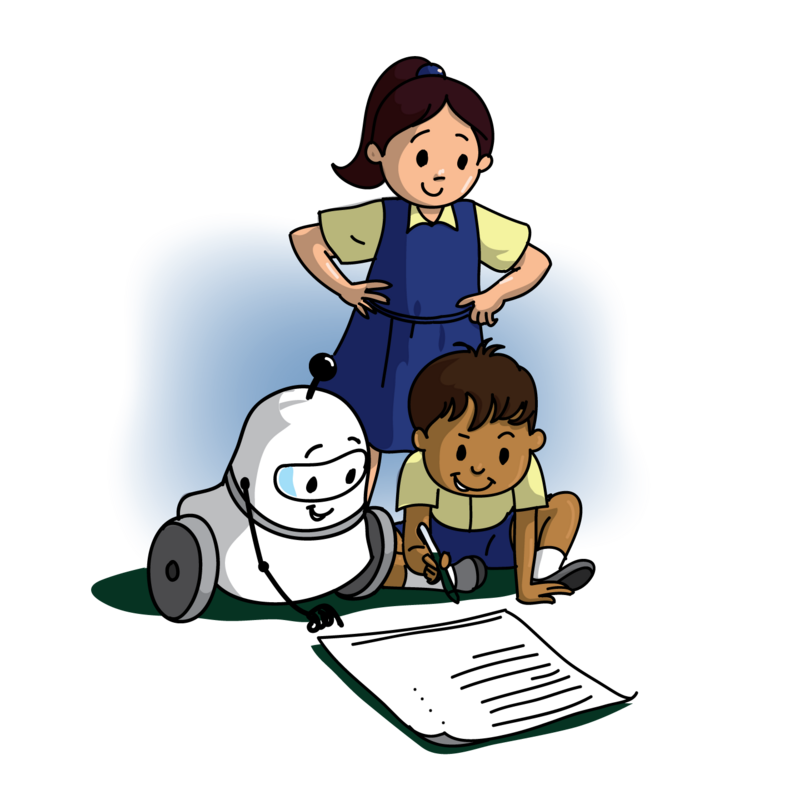

# Task 6: LSRB / RSLB Maze Logic

    

**Duration:** 1 week

## Brief

Junction types, detecting them with the IR array, priority rules, and turning without losing the line, all covered in [LSRB / RSLB](../../Learning/Introduction%20to%20robotics/LSRB%20RSLB.md). See [Putting It Together](../../Learning/Introduction%20to%20robotics/Putting%20It%20Together.md) for the full pseudocode combining junction detection with PID.

See [Assignment](Assignment.md) for what to submit.
