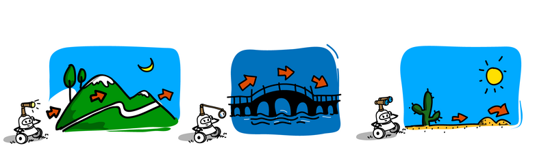

# Tasks

    

This is where everything from the Learning section gets put to use. Each task builds on the last, so work through them in order, and don't worry if a topic feels shaky, the Learning section is always there to revisit.

Every task has two parts: a **Brief**, which tells you what you're building and links back to the relevant Learning pages, and an **Assignment**, which tells you exactly what to submit and how.
